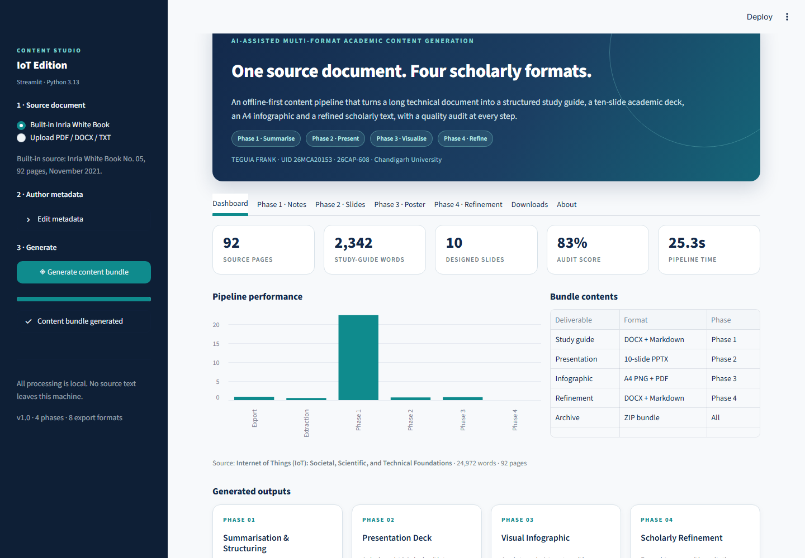

# AI-Assisted Multi-Format Academic Content Generation System

A local, deterministic content pipeline that converts one long technical document into four
academic formats:

| Phase | Deliverable | Formats |
|---|---|---|
| 1. Summarisation & Structuring | Comprehensive study guide, glossary, revision matrix, question bank | DOCX, Markdown |
| 2. Presentation Deck Generation | 10-slide academic deck with speaker notes | PPTX |
| 3. Visual Infographic Synthesis | A4 academic poster | PNG, PDF |
| 4. Scholarly Writing Refinement | Refined abstract, citations, audit checklist | DOCX, Markdown |

Built with **Python 3.13**, **Streamlit**, **python-docx**, **python-pptx**, **Pillow** and
**PyMuPDF**. It runs fully offline and needs no API key.

## Deliverables

- **12-page report:** [PDF](report/IoT_AI_Content_Generation_Mini_Project_Report_Teguia_Frank.pdf) ·
  [Word](report/IoT_AI_Content_Generation_Mini_Project_Report_Teguia_Frank.docx)
- **Demonstration bundle:** `outputs/demo_run/` — study guide, deck, poster, refinement,
  ZIP and `manifest.json`
- **Live interface:** `streamlit run app.py`



## Results at a glance

| Measure | Result |
|---|---|
| Source | 92 pages, 24,972 words, 204 sections |
| Study guide | 2,216 words (8.9%), 4 topics, 12 glossary terms, 11 fields |
| Deck | 10 slides with speaker notes |
| Poster | A4, 1654 × 2339 px at 200 dpi |
| Quality audit | 5 of 6 criteria verified (83.3%) |
| End-to-end runtime | 21.31 s, fully offline |

The report is exactly **12 pages**, verified with Microsoft Word's `ComputeStatistics(2)`
after repagination.

## Quick start

```bash
cd iot-content-studio
python -m pip install -r requirements.txt
streamlit run app.py
```

Open <http://localhost:8501>, keep the built-in Inria White Book source, and press
**Generate content bundle**.

## Command-line run

```bash
python -c "from pipeline import run_pipeline, ProjectMeta; r=run_pipeline('assets/source/whitebook_iot.pdf', ProjectMeta()); print(r.run_dir)"
```

The generated files appear under `outputs/run_<timestamp>/` with a `manifest.json` that records
source statistics, phase metrics, audit score and timings.

## Mini-project report

The submitted 12-page Word report is generated from the same manifest as the content bundle, so
its figures, tables and measurements stay consistent with the artefacts:

```bash
python report/build_report.py
python report/verify_report.py
```

`build_report.py` writes
`report/IoT_AI_Content_Generation_Mini_Project_Report_Teguia_Frank.docx`; `verify_report.py`
uses Microsoft Word on Windows to repaginate the file, print the page count and export the PDF.
The verification step needs Microsoft Word and `pywin32`. The report follows the reference
report's A4 geometry, running header, footer, heading and table styles, and contains six figures,
seven numbered tables in the main body and a code/verification appendix.

## Project layout

```
iot-content-studio/
├── app.py                      Streamlit application
├── pipeline/
│   ├── config.py               metadata, palette, stopwords
│   ├── textutils.py            sentence splitting, TF-IDF, readability
│   ├── extract.py              PDF/DOCX/TXT ingestion
│   ├── domain.py               source-grounded IoT profile
│   ├── phase1_notes.py         study-guide generation
│   ├── phase2_slides.py        PPTX deck builder
│   ├── phase3_infographic.py   A4 poster renderer
│   ├── phase4_refine.py        formalisation and audit
│   ├── exporters.py            DOCX / ZIP exporters
│   └── orchestrator.py         end-to-end run and manifest
├── assets/source/              built-in white book
├── outputs/                    generated bundles
├── report/
│   ├── build_report.py         report generator
│   ├── verify_report.py        Word page count and PDF export
│   ├── figures/                report figures and screenshots
│   └── IoT_AI_Content_Generation_Mini_Project_Report_Teguia_Frank.docx / .pdf
└── requirements.txt
```

## Deploy on Streamlit Community Cloud

1. Push this folder to a public GitHub repository.
2. Go to <https://share.streamlit.io> → **New app**.
3. Select the repository, branch `main`, and entry point `app.py`.
4. Deploy. No secrets or API keys are required.

## Notes on method

Phase 1 uses TF-IDF sentence ranking with a diversity penalty, definition-pattern mining and
template-based question generation. The IoT case study adds a source-grounded domain profile
(terminology, fact bank and canonical research fields). Phase 2 and Phase 3 are deterministic
layout engines: the same input always produces the same deck and poster. Phase 4 applies a
transparent formal-style ruleset and reports the before/after readability metrics rather than
claiming an unverifiable improvement.

## Source attribution

The bundled `assets/source/whitebook_iot.pdf` is *Internet of Things (IoT): Societal Challenges
& Scientific Research Fields for IoT* (Inria White Book No. 05, 2021), used as the offline case
study. The document remains the property of its authors and is included only as the
demonstration corpus. All generated artefacts in this repository are derived from that source
and the project's own review layer.
